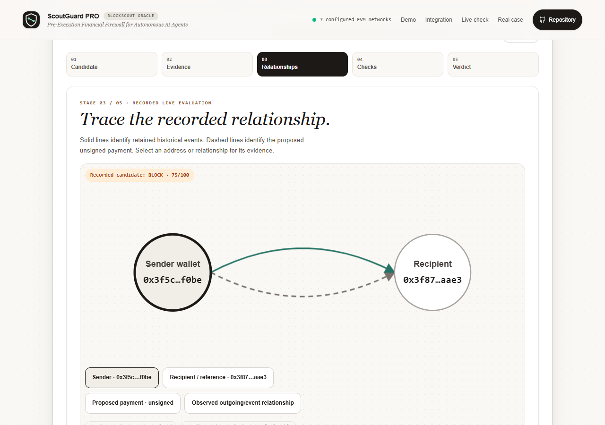

# ScoutGuard PRO

**A pre-signing payment check for EVM agents and treasury tools.** ScoutGuard inspects an unsigned native or canonical USDC transfer, retrieves Blockscout evidence, applies a deterministic policy, and returns `PASS`, `FLAG`, or `BLOCK`. It never holds a wallet key, signs, or broadcasts.

[Open the dashboard](https://scoutguard.vercel.app/) · [Judge quickstart](docs/submission/JUDGE_START_HERE.md) · [Sprint 2 evidence](docs/submission/JUDGING_EVIDENCE.md) · [Verification matrix](docs/FINAL_ACCEPTANCE_MATRIX.md)

> **Release status:** This branch's live evidence inspector and live-first layout are verified in draft PR #5 but not yet merged/deployed. The hosted URL currently serves the previous release. The project owner has the Craftora, X, and recording copy in chat for publication after release.




*Recorded replay captured in the local browser test. It reads the saved case archive and makes no fresh Blockscout request.*

## Try it

| Experience | Where | What happens |
| --- | --- | --- |
| **Live evaluation** | Dashboard → Run live Blockscout check | A fresh, bounded Ethereum lookup for an unsigned ETH or canonical USDC payment. The new inspector shows actual upstream request statuses, parsed observations, relationship evidence, checks and an export. It may return `FLAG` or fail-closed `BLOCK`. |
| **Recorded live evaluations** | Dashboard → Recorded replay | Five-stage playback of three saved, partial production observations. Pause, inspect the graph and checks, follow Explorer links, and download a sanitized excerpt. No new Blockscout requests. |
| **Simulated attacks** | Dashboard → Simulated attacks | Fixture-driven vendor, look-alike, unverified-contract, phishing-tag, and cap-breach examples. These are labeled simulations. |

Judges can use the public live form without a service key. **None of the proposed example payments was sent.** An Explorer link supports the displayed address or historical event, not a claim that ScoutGuard prevented a loss.

## Run locally

Requires Node.js 22+ and npm. Use a recent Chromium browser for optional browser tests.

```bash
npm ci
npm run build
npm test
npm start
```

Open `http://localhost:3030`. Replay and simulations work without provider credentials. For fresh Blockscout checks, copy `.env.example` to `.env` and set `BLOCKSCOUT_API_KEY`. Without it, the app attempts public Explorer endpoints; if required data is unavailable, the payment cannot pass. Keep TLS verification enabled.

On Windows, if Node reports `UNABLE_TO_VERIFY_LEAF_SIGNATURE` while the browser can reach Blockscout, use Node's system CA support (`NODE_USE_SYSTEM_CA=1`) with TLS verification still enabled. Do not disable certificate validation or expose the provider key in browser code.

Set a long random `SCOUTGUARD_SERVICE_KEY` for the protected agent API. Its policy identity is `SCOUTGUARD_AGENT_ID` (default `procurement-bot-01`). A request for another policy returns 403 before provider access. Use a separate deployment and key for a different policy; the single key is not a multi-tenant identity system. Production requires both the service and Blockscout keys. Confirmed Vercel previews may start without them; protected access remains locked, while the public form can still attempt public Explorer requests.

Keep service keys, provider keys, wallet keys, and `.env` contents out of Git, browser code, screenshots, and recordings.

## Payment and API contract

`POST /api/evaluate/public` accepts strict JSON for Ethereum (`chainId: 1`). `to` is the **unsigned transaction destination**. For ETH, `value` is a positive decimal native amount and `data` is absent. For USDC, `to` is the canonical token contract, `value` is `"0"`, and `data` encodes `transfer(beneficiary, rawAmount)`.

```bash
curl -X POST http://localhost:3030/api/evaluate/public \
  -H 'Content-Type: application/json' \
  -d '{"from":"0x3f5ce5fbfe3e9af3971dd833d26ba9b5c936f0be","to":"0x3f8702cfb1662195fcc98593789682da91dfaae3","value":"0.1","chainId":1}'
```

That command makes a **real provider request** if the server has network access. A valid candidate is not guaranteed to pass. Construct a direct USDC transfer with ethers:

```ts
import { Interface, parseUnits } from 'ethers';

const USDC_ETHEREUM = '0xa0b86991c6218b36c1d19d4a2e9eb0ce3606eb48';
const data = new Interface(['function transfer(address,uint256)'])
  .encodeFunctionData('transfer', [beneficiary, parseUnits('250', 6)]);
const candidate = { from: sender, to: USDC_ETHEREUM, value: '0', data, chainId: 1 };
```

The public route returns `{ mode: "LIVE", source, evaluation }`. `source` is derived from successful per-request telemetry: `BLOCKSCOUT_PRO`, `BLOCKSCOUT_PUBLIC_API`, `MIXED_BLOCKSCOUT_SOURCES`, or a `_PARTIAL` variant when some requests failed; fully failed or untraced results use `BLOCKSCOUT_UNAVAILABLE` or `NO_PROVIDER_TRACE`. An environment variable or local fixture cannot by itself claim a successful PRO lookup. `evaluation.providerTrace` records only sanitized endpoint IDs, chain, status, duration, timestamp, page and row counts, pagination and error categories; it never includes a credential-bearing URL. `evaluation.providerObservations` exposes the parsed address/counter/contract facts actually used by the check. Protected `POST /api/evaluate` takes the same candidate plus `x-scoutguard-key` and returns the evaluation directly. Send it only from a trusted server over HTTPS. `GET /api/counterparties` requires the same key because configured counterparties can be private.

The receipt records the effective beneficiary, original transaction destination, exact base-unit amount, calldata, checks, history coverage, sanitized trace/observations, policy version, and Explorer address link. An agent must bind the response to the transaction it will sign and independently authorize it. The [mock adapter](src/integration/payment-agent.ts) demonstrates this. `npm run demo:agent` uses no wallet or network; its `SIGNED` result is a synthetic artifact, not signed EVM bytes.

## How decisions work

1. **Normalize the exact unsigned payment.** Reject malformed addresses/amounts, contradictory assertions, arbitrary calldata, zero beneficiaries, and unsupported assets. Only direct `transfer(address,uint256)` to canonical USDC is supported: Ethereum `0xa0b86991c6218b36c1d19d4a2e9eb0ce3606eb48` and Base `0x833589fcd6edb6e08f4c7c32d4f71b54bda02913`. Base decoding is tested; recorded PRO access to Base returned 402.
2. **Retrieve bounded Blockscout evidence.** Inspect recipient metadata, counters, contract verification, and recent native/ERC-20 sender history. The scanner follows v2 pagination, deduplicates events, and distinguishes outgoing, incoming-only, zero-value, and incomplete records. Incoming dust does not establish a trusted payee.
3. **Apply checks.** Compare the effective recipient with observed outbound and operator-configured references. A different address matching at least four leading **and** four trailing hex characters blocks; weaker resemblance flags. Check tags, source verification, chain permissions, recipient allowlists, and exact per-payment caps. Source verification is not a contract audit.
4. **Return a conservative verdict.** Critical provider failure blocks; incomplete but usable history cannot `PASS` and requires review. A `PASS` means these checks passed against retrieved evidence and policy, not that a recipient or transaction is safe.

Default procurement policy: native cap 2.5 and review above 1; USDC cap 2,500 and review above 1,000. These are asset-specific amounts, not exchange-rate comparisons. Public evaluations use this policy.

Default provider bounds: three history pages per endpoint, 300 combined rows, eight history calls, 12 total provider calls, 10-second evaluation deadline, four-second request timeout, 2 MB response limit, and 250 ms process-local spacing. The public route also has five requests/minute/client, 20/minute/process, two concurrent evaluations, and a provider-failure cooldown. JSON is limited to 16 KB. These controls are **not** a deployment-wide quota across instances or cold starts.

## Evidence and replay provenance

The player separates **LIVE**, **RECORDED LIVE**, **RECORDED RESEARCH**, and **SIMULATED** modes. Its archived production cases are partial transcriptions: original exact API times, receipt IDs, and complete inbound/trust lists were not retained. Graph relationships use only saved supporting data. Downloads disclose the missing fields; they are not original provider responses.

The separate [Poison-Hunter research example](docs/evidence/2026-10-23-recorded-poisoning-replay.md) shows how the similarity rule responds **if** a published historical reference is supplied. A previous live scan did not recover that older reference. ScoutGuard has not been shown to have prevented that historical event.

The receipt SHA-256 digest is **unkeyed**. It checks consistency, but anyone able to forge a response can recompute it; it is not an authenticated Blockscout signature or authorization token. The mock agent adapter relies on trusted HTTPS transport, exact transaction/policy binding, freshness, complete history for `PASS`, and a separate authorization callback. Real wallet, nonce, gas, idempotency, and executed-spend controls remain downstream work.

## Verify

```bash
npm run build
npm run typecheck
npm test
npm run demo:agent
npm run test:browser
npm audit --audit-level=high
```

`test:browser` uses an installed Chromium executable (`CHROMIUM_PATH` if needed), a loopback fixture server, and blocks external resources. Its live-form checks use **synthetic** provider data. The tests cover auth, fail-closed behavior, parsing, payment binding, history coverage, cancellation, replay provenance, responsive UI, and mock-agent enforcement. They do not prove a fresh production Blockscout evaluation or real-wallet safety. See the [verification matrix](docs/FINAL_ACCEPTANCE_MATRIX.md) for the evidence boundary.

Manual genuine-provider checks are deliberately separate from CI. `node scripts/smoke-live.mjs --one-approved-case` makes one public live evaluation (or `--three-approved-cases` makes three). `scripts/capture-live-evidence.mjs` captures one traced localhost evaluation only when explicitly invoked with `SCOUTGUARD_SMOKE_ORIGIN=http://localhost:3030/` and `--one-approved-capture`. These commands consume provider requests. The [25 October successful local trace](docs/evidence/2026-10-25-successful-local-smoke.md) recorded eight real PRO HTTP 200 responses and a conservative `FLAG`; a later [timeout trace](docs/evidence/2026-10-25-local-provider-timeout.json) recorded the expected fail-closed `BLOCK`. Neither is a deployed-upgrade verification.

## Deployment and limits

The Express app exports a Vercel-compatible entry point and serves `public/`; the Dockerfile builds the same TypeScript app as a non-root image. Configure the two required production secrets in the host and verify public and protected routes after deployment. See [release migration notes](docs/RELEASE_MIGRATION.md).

- Seven EVM chains are configured, not all live-verified or accessible under the current Blockscout plan. Ethereum has preserved live evidence; Base was plan-gated in the recorded check.
- History is bounded indexed data at lookup time, not every past, internal, or future transfer. Similarity thresholds are heuristics without measured false-positive or prevention rates.
- Shared quotas, authoritative hourly executed-spend accounting, authenticated receipts, a human-approval workflow, and real-wallet enforcement are not implemented.
- The [approved release record](docs/evidence/2026-10-24-approved-release.md) verifies authenticated production content/health. Fresh anonymous/provider/Explorer verification of this release remains a separate open gate there.

Craftora text and demo materials in [`docs/`](docs/) are drafts until published. `package.json` declares MIT, but this repository has no `LICENSE` file; confirm the intended license before reuse or redistribution.
